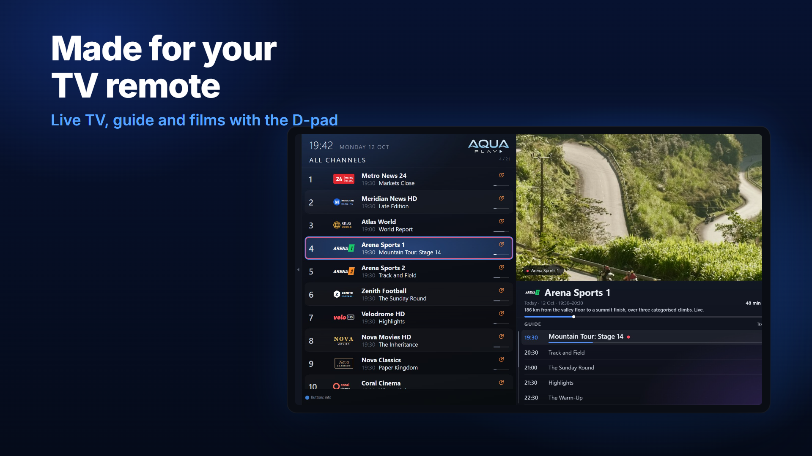
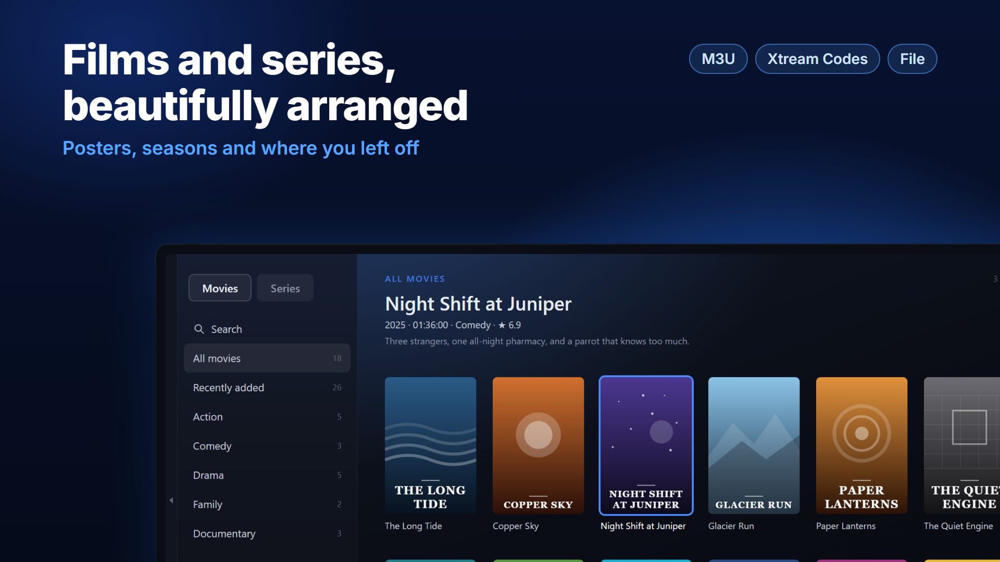

# AquaPlay IPTV for Android TV and Fire TV

An IPTV player made for the TV remote: live TV, the TV guide, catch-up, films and series from your own playlist.



**On Android TV with Google Play:** [get AquaPlay on Google Play](https://play.google.com/store/apps/details?id=com.aquaplay.tv). Updates come by themselves.

**On a Fire TV Stick, or a box without Google Play:** install it with the Downloader app (below), with the code **1167505**. It is always the newest version, from this link:

```
https://github.com/AquaPlayIPTV/aquaplay-android/releases/latest/download/AquaPlay.apk
```

This repository holds the releases of the Android app. AquaPlay's source code is not published.

AquaPlay is a player only and comes with no channels or content: you need a playlist from your own provider.

## Install on a Fire TV Stick

1. **Get Downloader**: on the Fire TV, search for *Downloader* and install it (it is free, by AFTVnews).
2. **Allow it to install apps**: *Settings → My Fire TV → Developer options → Install unknown apps*, and switch Downloader on. If there are no *Developer options*, open *Settings → My Fire TV → About*, press OK on your device's name seven times, and go back.
3. **Download AquaPlay**: open Downloader, type **1167505** into its address box and choose *Go*. (The link above works too.)
4. **Install** when asked, then **Open**. Downloader offers to delete the downloaded file afterwards; you can.

## Updating

Do the same again: the code 1167505 always gives the newest version. It installs over the old one and keeps your playlists and settings. (From Google Play, updates are automatic.)

## Premium

The Premium features (multi-view, recording, more than one playlist, profiles, parental PIN, catch-up further back, the guide beyond today, your own channel numbers, the sleep timer and two themes) come with AquaPlay from Google Play: free for 7 days there, then bought through Google Play. **Installed with Downloader there is no free trial, and on a device without Google Play, such as a Fire TV Stick, Premium cannot be bought.** Everything else in AquaPlay is free.


