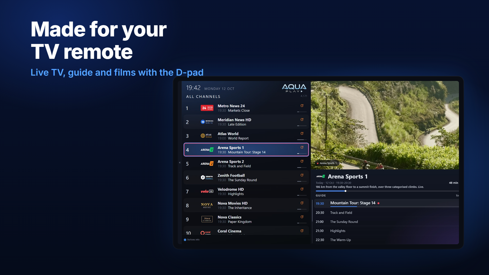
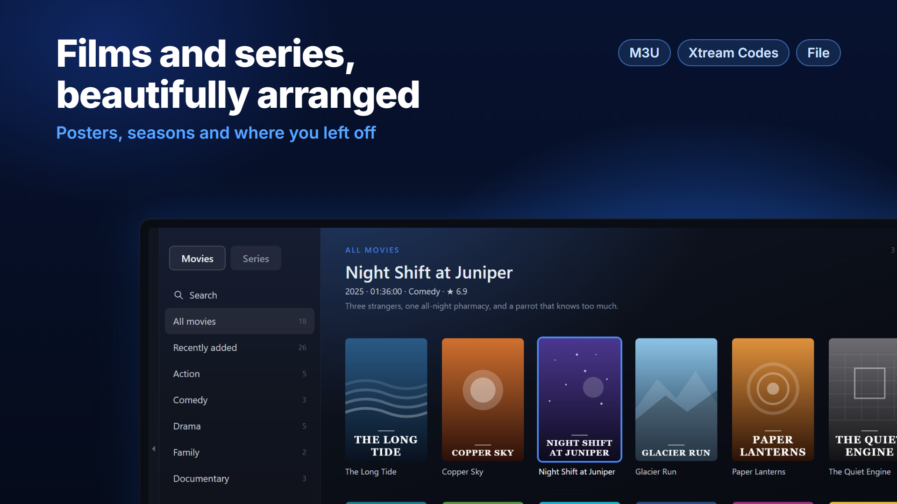

# AquaPlay IPTV for Android TV and Fire TV

An IPTV player made for the TV remote: live TV, the TV guide, catch-up, films and series from your own playlist.



**On Android TV with Google Play:** [get AquaPlay on Google Play](https://play.google.com/store/apps/details?id=com.aquaplay.tv). Updates come by themselves.

**On a Fire TV Stick, or a box without Google Play:** install it with the Downloader app (below), with the code **1167505**. It is always the newest version, from this link:

```
https://github.com/AquaPlayIPTV/aquaplay-android/releases/latest/download/AquaPlay.apk
```

This repository holds the releases of the Android app. AquaPlay's source code is not published.

AquaPlay is a player only and comes with no channels or content: you need a playlist from your own provider.

## Install on a Fire TV Stick

1. **Get Downloader**: on the Fire TV, search for *Downloader* and install it (it is free, by AFTVnews).
2. **Allow it to install apps**: *Settings → My Fire TV → Developer options → Install unknown apps*, and switch Downloader on. If there are no *Developer options*, open *Settings → My Fire TV → About*, press OK on your device's name seven times, and go back.
3. **Download AquaPlay**: open Downloader, type **1167505** into its address box and choose *Go*. (The link above works too.)
4. **Install** when asked, then **Open**. Downloader offers to delete the downloaded file afterwards; you can.

## Updating

Do the same again: the code 1167505 always gives the newest version. It installs over the old one and keeps your playlists and settings. (From Google Play, updates are automatic.)

## What it does

- M3U playlists, Xtream Codes accounts and MAG (Stalker) portals; set up from your phone by scanning a code on the TV
- Live TV with groups, favourites and recently watched, the schedule beside the list or a guide grid, reminders and search across channels and programmes
- Catch-up where your provider has it: replay programmes, start one over, rewind live TV
- Movies & Series: sort, hide watched, jump by letter, Continue watching, Skip intro and Up next, Simkl
- Subtitles in a panel beside the picture, found online (OpenSubtitles), with sync, size and colour
- A choice of player for films, series, catch-up and channels: Auto, ExoPlayer or Nova
- 16 languages, no advertisements, no tracking, no account

## Free and Premium

Everyday watching with one playlist is free and complete. Premium adds the extras, all together for one price: **$5 a month, $10 a year or $25 for good**, bought through Google Play, with a free 7-day trial there.

Premium includes: multi-view (up to four channels at once), recording, more than one playlist and sending to another TV, your own channel groups, backup and restore, catch-up further back than the last day, the TV Catalogue beyond today and reminders, more than one guide read together, profiles, the parental PIN and locked channels, your own channel numbers and remote buttons, the sleep timer and delay warning, subtitles found online, more subtitle styles and subtitles from your phone, and the OLED and Custom themes. The full list is on the [Free and Premium page](https://dolev24.github.io/aquaplay-iptv/features.html).

**Installed with Downloader there is no free trial, and on a device without Google Play, such as a Fire TV Stick, Premium cannot be bought.** Everything else in AquaPlay is free.



## Questions, problems and ideas

Ask on our **[Discord](https://discord.gg/5A5mDrwK8w)**, report a bug with an [issue](https://github.com/AquaPlayIPTV/aquaplay-android/issues), or write to devdolev@gmail.com. The [privacy policy](https://aquaplayiptv.github.io/privacy.html) says what AquaPlay keeps and sends.

Follow **[@AquaPlayIPTV](https://x.com/AquaPlayIPTV)**

## Also on Samsung TVs

AquaPlay is free, with everything included, on Samsung Smart TVs: [aquaplay-samsung](https://github.com/AquaPlayIPTV/aquaplay-samsung).
